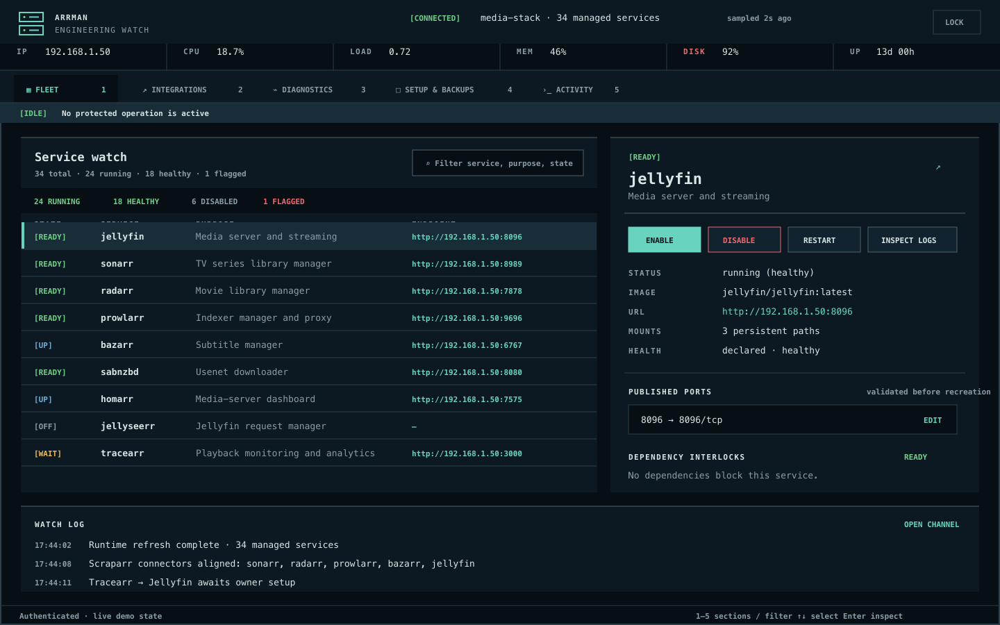
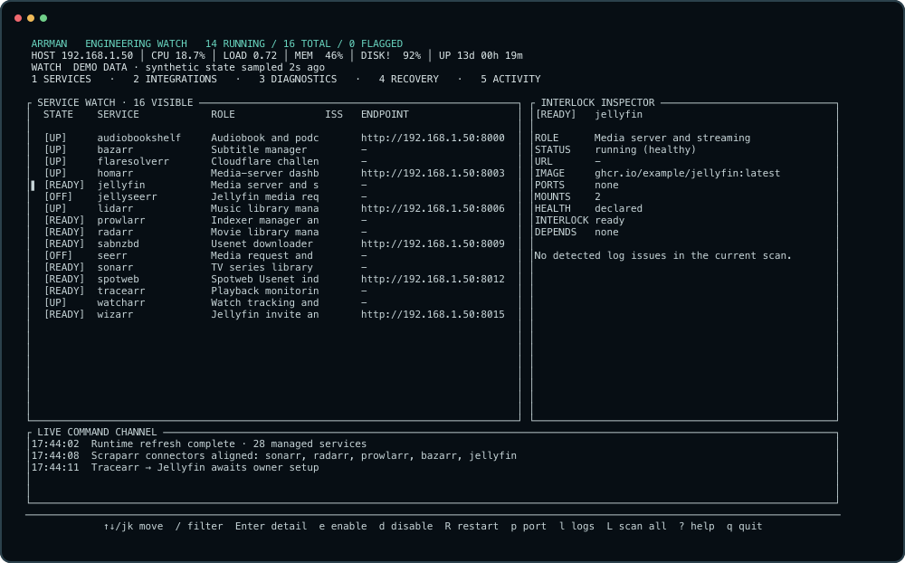

<p align="center">
  
</p>

<h1 align="center">Arrman</h1>

<p align="center"><strong>Your media stack, under one watch.</strong></p>

<p align="center">
  A fast Rust control plane that reconciles Docker Compose intent, live containers,<br>
  dependencies, health, logs, integrations, ports, and recoverable configuration.
</p>

<p align="center">
  <a href="https://github.com/kevinelliott/arrman/actions/workflows/ci.yml"></a>
  <a href="https://github.com/kevinelliott/arrman/actions/workflows/container.yml"></a>
  <a href="https://github.com/kevinelliott/arrman/releases/latest"></a>
  <a href="https://github.com/kevinelliott/arrman/pkgs/container/arrman"></a>
  <a href="LICENSE"></a>
  
</p>

<p align="center">
  <a href="#quick-start">Quick start</a> ·
  <a href="docs/SUPPORTED_SERVICES.md">Supported services</a> ·
  <a href="#configuration-recovery">Recovery</a> ·
  <a href="CONTRIBUTING.md">Contributing</a>
</p>



<p align="center"><sub>Sanitized deterministic demo state; no private stack data.</sub></p>

Arrman gives a self-hosted media administrator one consistent view of the
Compose file and the Docker runtime. The TUI and optional authenticated web UI
share the same operation lock, live activity stream, enablement intent, and
backup scheduler, so a change made in one surface appears in the other.

## Why Arrman

| See | Act | Recover |
| --- | --- | --- |
| Host CPU, load, memory, disk, uptime, service state, URLs, ports, health checks, dependency readiness, and log findings | Enable or durably disable graph-aware services, restart safely, edit ports, apply integrations, and follow streaming progress | Create versioned setup bundles, retain scheduled backups, inspect local or HTTPS imports, and restore behind an exact confirmation and rollback guard |

- Fast keyboard navigation stays responsive while Docker pulls and integration
  work continue in the background.
- `--json` emits one stable, decoration-free snapshot for automation.
- Service actions resolve transitive dependencies and dependents in safe order.
- Log signatures produce evidence, manual repair guidance, and only bounded,
  confirmable automatic fixes.
- API keys are never serialized into plans, snapshots, activity, or errors.
- Any valid Compose service is visible and manageable; the catalog adds richer
  names, dependency ownership, diagnostics, and integration behavior.

## Interfaces

### Terminal watch



<p align="center"><sub>Generated by Arrman's real <code>--demo --snapshot</code> renderer.</sub></p>

Use arrows or `j`/`k` to move, `/` to filter, `1`–`5` to switch sections,
`e`/`d` to enable or disable, `p` to edit a port, `l` to inspect logs, `a` to
review integrations, `?` for the full keyboard card, and `q` to quit. Long
operations are written to the command channel instead of painting over the TUI.

### Web control room

`--web` runs the browser control room beside the TUI; `--web-only` is suitable
for a supervised process or container. It provides realtime fleet state,
protected actions, diagnostics, integration reconciliation, and setup bundle
export/import.

The listener defaults to `127.0.0.1:9876`. Keep that safe default and use an SSH
tunnel:

```sh
ssh -L 9876:127.0.0.1:9876 admin@media-server
```

Open `http://127.0.0.1:9876`. On first launch Arrman creates a random bearer
token beside the managed Compose file in `.docker-services-web-token`, mode
`0600`. The browser keeps it in session storage, never in a URL. A non-loopback
plain-HTTP bind should only sit on a trusted network behind a TLS reverse proxy.

## Quick start

Arrman requires Linux, Docker Engine, and Docker Compose v2. The process needs
permission to read and update the managed Compose file and to use the Docker
socket.

### Release binary

Download the architecture-matched binary and checksum from the
[latest release](https://github.com/kevinelliott/arrman/releases/latest):

```sh
arrman_version=v1.0.0
curl -fLO "https://github.com/kevinelliott/arrman/releases/download/${arrman_version}/arrman-${arrman_version}-linux-x86_64"
curl -fLO "https://github.com/kevinelliott/arrman/releases/download/${arrman_version}/SHA256SUMS"
sha256sum --check --ignore-missing SHA256SUMS
install -m 0755 "arrman-${arrman_version}-linux-x86_64" /usr/local/bin/arrman
```

Then point Arrman at the stack:

```sh
arrman --compose-file /opt/media-stack/docker-compose.yml --host 192.168.1.50
arrman --compose-file /opt/media-stack/docker-compose.yml --host 192.168.1.50 --json
arrman --compose-file /opt/media-stack/docker-compose.yml --host 192.168.1.50 --web
```

### Docker Compose

The published image includes the Docker CLI and Compose plugin. Copy the example
environment, set the host paths and existing media-stack network, then start the
loopback-only web service:

```sh
cp .env.example .env
mkdir -p /nfs/arrman/backups
docker compose config
docker compose up -d
docker compose logs -f arrman
```

The stack directory and durable service-state root are mounted at the same
absolute paths inside the container. This preserves relative Compose semantics
and lets setup bundles read bind-mounted configuration. Arrman also joins the
existing media network so application APIs remain reachable by Compose service
name.

> [!WARNING]
> Mounting `/var/run/docker.sock` gives the container host-level Docker control.
> Treat Arrman as an administrative service, keep the web port on loopback, and
> do not expose it to untrusted users or networks.

For a containerized TUI, keep the same mounts and network and run with a terminal:

```sh
docker compose run --rm arrman \
  --compose-file "${MEDIA_STACK_DIR}/${MEDIA_COMPOSE_FILE}" \
  --backup-dir /backups \
  --host "${MEDIA_SERVER_HOST}"
```

## Supported services

Arrman currently recognizes **34 named services**, including application-owned
database, cache, and worker dependencies:

- Audiobookshelf, Autopulse, Bazarr, Decluttarr, FlareSolverr, Floppy, Homarr,
  Jellyfin, Jellyseerr, Kapowarr, Lidarr, Maintainerr, Posterizarr, Prefetcharr,
  Prowlarr, Pulsarr, Radarr, SABnzbd, Scraparr, Seerr, Sonarr, Spotweb, Tdarr,
  Tracearr, Trailarr, Unpackarr, Watcharr, and Wizarr.
- Autopulse PostgreSQL, Floppy Redis, Spotweb MySQL, Tdarr Node, Tracearr Redis,
  and Tracearr Timescale dependency services.

The [full supported-service catalog](docs/SUPPORTED_SERVICES.md) lists each
Compose name, purpose, dependency role, upstream project, and the integration
paths Arrman can reconcile. Health checks and ordinary `depends_on` edges are
read dynamically from Compose, so custom services still receive core status,
URL, enable/disable, restart, port, and dependency handling.

## Dynamic dependencies and integrations

Arrman recalculates behavior from current Compose intent every time a service is
enabled, disabled, or moved to a different port:

- Enable resolves transitive dependencies in start order and honors
  `service_started`, `service_healthy`, and completion conditions.
- Disable resolves active dependents in stop order and durably records intent;
  it is not merely `docker stop`.
- Application-owned dependencies such as Redis, PostgreSQL, MySQL, Timescale,
  and Tdarr Node follow their owning service without taking unrelated consumers
  down.
- Integration plans cover SABnzbd allow-list/download-client links, Prowlarr
  application links, Scraparr connectors, and Tracearr/Jellyfin setup. Plans are
  recalculated after port or enablement changes and applied only after review.
- Existing application fields are preserved during updates, and secrets remain
  local to the request that needs them.

## Configuration recovery

While either interactive surface is running, a shared scheduler checks the
backup policy. Defaults are every 24 hours with 14 retained bundles; configure
them with `--backup-dir`, `--backup-interval-hours`, and `--backup-retention`.
Create one immediately with:

```sh
arrman --compose-file /opt/media-stack/docker-compose.yml \
  --backup-dir /srv/backups/arrman \
  --backup-now
```

Schema-v3 setup bundles include Compose and environment intent, durable disabled
state, configuration bind mounts, named-volume data, checksums, exclusions, and
service UID/GID metadata. Media libraries, downloads, caches, logs, generated
artwork, devices, sockets, and nested backups are excluded. Bundles can contain
application credentials and must be handled as secrets.

Restore is deliberately guarded: inspect and hash, enter the exact confirmation,
create a pre-restore bundle, stop the stack, stage and validate paths, restore,
validate Compose, then start enabled services in dependency order. A failure
attempts rollback and restart of the previous stack.

## Contributing a missing service

Compose discovery already gives an unknown service the generic control path. A
first-class contribution can then add its purpose, owned dependencies, health
expectations, diagnostics, and optional idempotent integration adapter.

See [CONTRIBUTING.md](CONTRIBUTING.md) for the file map, fixture requirements,
redaction rules, tests, and pull-request checklist. A good service contribution
includes:

1. An upstream repository and maintained container image.
2. A minimal sanitized Compose fixture with dependencies and health check.
3. Purpose metadata and any exclusive dependency ownership.
4. Safe, repeatable integration behavior with preserved unknown fields.
5. Tests for enable, disable, port-change, failure, and secret-redaction paths.
6. A matching entry in `docs/SUPPORTED_SERVICES.md`.

Use the [service support request](https://github.com/kevinelliott/arrman/issues/new?template=service-support.yml)
if you have the service details but are not ready to write Rust.

## Build and verify

```sh
cargo fmt --all -- --check
node --check src/web_assets/app.js
node scripts/verify-docs.mjs
cargo clippy --locked --all-targets --all-features -- -D warnings
cargo test --locked
cargo build --release --locked
docker build --build-arg VERSION=local --tag arrman:local .
```

Deterministic TUI snapshots require no Docker daemon:

```sh
cargo run --locked -- --demo --snapshot --width 136 --height 42
cargo run --locked -- --demo --snapshot --width 100 --height 40
cargo run --locked -- --demo --snapshot --width 80 --height 28
```

GitHub Actions checks Rust 1.88, JavaScript syntax, documentation/catalog drift,
strict Clippy, tests, the release build, and the Docker image. Version tags build
static x86_64 and aarch64 Linux binaries, publish checksums, create a GitHub
release, and publish a multi-architecture GHCR image with provenance and SBOM.

## Related resources

- [Awesome *Arr](https://github.com/Ravencentric/awesome-arr) — a broad catalog
  of *Arr applications and companion projects.
- [Servarr Wiki](https://wiki.servarr.com/) — consolidated documentation for
  Sonarr, Radarr, Lidarr, Prowlarr, and related applications.
- [TRaSH Guides](https://trash-guides.info/) — community configuration guidance
  for media automation stacks.
- [Docker Compose documentation](https://docs.docker.com/compose/) — the runtime
  model Arrman reads and validates.
- [Supported services](docs/SUPPORTED_SERVICES.md) — direct links to every
  upstream application represented in the built-in catalog.

## Security

Commands are executed as explicit argument vectors, service names and ports are
validated, Compose writes are backed up and validated, web mutations require a
bearer token, and setup imports reject archive traversal, unsafe links,
oversized expansion, redirects, private/reserved URL destinations, and DNS
rebinding. See [SECURITY.md](SECURITY.md) to report a vulnerability privately.

## License

Arrman is available under the [MIT License](LICENSE). Individual managed
services retain their own licenses and are not bundled with Arrman.
